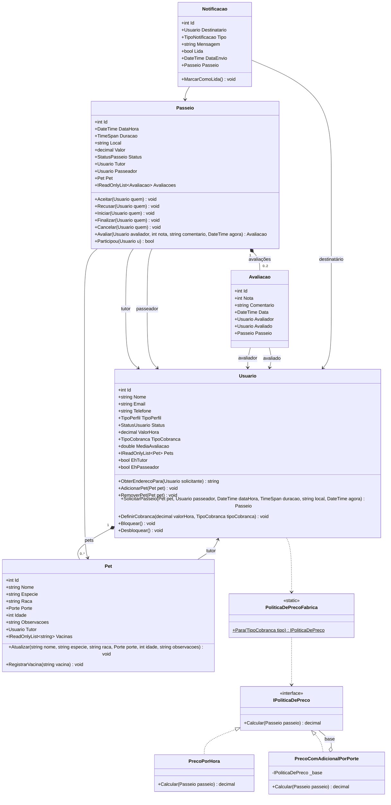

# Modelo de Classes — PetWalk

> Propriedades privadas omitidas do diagrama: `_endereco`, `_pets`, `_avaliacoesRecebidas` (Usuario); `_avaliacoes` (Passeio); `_vacinas` (Pet). Construtores privados para materialização pelo EF Core também omitidos.

## Mapeamento Classe → Arquivo

| Classe / Interface | Arquivo | Pasta |
|---|---|---|
| Usuario | Usuario.cs | backend/Projeto.Api/Dominio/ |
| Pet | Pet.cs | backend/Projeto.Api/Dominio/ |
| Passeio | Passeio.cs | backend/Projeto.Api/Dominio/ |
| Avaliacao | Avaliacao.cs | backend/Projeto.Api/Dominio/ |
| Notificacao | Notificacao.cs | backend/Projeto.Api/Dominio/ |
| IPoliticaDePreco | IPoliticaDePreco.cs | backend/Projeto.Api/Dominio/ |
| PrecoPorHora | PrecoPorHora.cs | backend/Projeto.Api/Dominio/ |
| PrecoComAdicionalPorPorte | PrecoComAdicionalPorPorte.cs | backend/Projeto.Api/Dominio/ |
| PoliticaDePrecoFabrica | PoliticaDePrecoFabrica.cs | backend/Projeto.Api/Dominio/ |

## Enums Relevantes

| Enum | Valores | Arquivo |
|---|---|---|
| TipoPerfil | TUTOR, PASSEADOR, AMBOS | Enums.cs |
| StatusPasseio | SOLICITADO, ACEITO, EM_ANDAMENTO, FINALIZADO, RECUSADO, CANCELADO | Enums.cs |
| StatusUsuario | ATIVO, BLOQUEADO | Enums.cs |
| TipoCobranca | POR_HORA, POR_HORA_COM_ADICIONAL_DE_PORTE | Enums.cs |
| Porte | PEQUENO, MEDIO, GRANDE | Enums.cs |
| TipoNotificacao | PASSEIO_SOLICITADO, PASSEIO_ACEITO, PASSEIO_RECUSADO, PASSEIO_INICIADO, PASSEIO_FINALIZADO, PASSEIO_CANCELADO | Enums.cs |

## Atributos e Métodos Relevantes por Classe

### Usuario

| Membro | Tipo | Visibilidade | Observação |
|---|---|---|---|
| Id | int | público 🔒 | setter privado |
| Nome | string | público 🔒 | setter privado |
| Email | string | público 🔒 | setter privado |
| Telefone | string | público 🔒 | setter privado |
| TipoPerfil | TipoPerfil | público 🔒 | setter privado |
| Status | StatusUsuario | público 🔒 | setter privado |
| ValorHora | decimal | público 🔒 | setter privado |
| TipoCobranca | TipoCobranca | público 🔒 | setter privado |
| MediaAvaliacao | double | público 🔒 | setter privado |
| Pets | IReadOnlyList<Pet> | público | coleção somente leitura; _pets privado |
| EhTutor | bool | público | propriedade calculada |
| EhPasseador | bool | público | propriedade calculada |
| _endereco | string | privado 🔒 | acessível só via ObterEnderecoPara() |
| ObterEnderecoPara(solicitante) | string | público | lança se solicitante != this |
| AdicionarPet(pet) | void | público | REG-002, REG-005 |
| RemoverPet(pet) | void | público | |
| SolicitarPasseio(...) | Passeio | público | REG-002, REG-005, REG-008, REG-009 |
| DefinirCobranca(valorHora, tipoCobranca) | void | público | exige EhPasseador |
| Bloquear() / Desbloquear() | void | público | altera Status |
| DefinirId(id) | void | internal 🔒 | usado só pelo repositório |

### Pet

| Membro | Tipo | Visibilidade | Observação |
|---|---|---|---|
| Id | int | público 🔒 | setter privado |
| Nome | string | público 🔒 | setter privado |
| Especie | string | público 🔒 | setter privado |
| Raca | string | público 🔒 | setter privado |
| Porte | Porte | público 🔒 | setter privado |
| Idade | int | público 🔒 | setter privado; 0–30 |
| Observacoes | string | público 🔒 | setter privado |
| Tutor | Usuario | público | referência ao dono |
| Vacinas | IReadOnlyList<string> | público | _vacinas privado |
| Atualizar(...) | void | público | valida Nome e Idade |
| RegistrarVacina(vacina) | void | público | |

### Passeio

| Membro | Tipo | Visibilidade | Observação |
|---|---|---|---|
| Id | int | público 🔒 | setter privado |
| DataHora | DateTime | público 🔒 | setter privado |
| Duracao | TimeSpan | público 🔒 | setter privado |
| Local | string | público 🔒 | setter privado |
| Valor | decimal | público | calculado no construtor, sem setter |
| Status | StatusPasseio | público 🔒 | alterado só por transições |
| Tutor / Passeador / Pet | referências | público | sem setter |
| Avaliacoes | IReadOnlyList<Avaliacao> | público | _avaliacoes privado |
| Aceitar / Recusar / Iniciar / Finalizar(quem) | void | público | exigem ExigirPasseadorAtivo + ExigirStatus |
| Cancelar(quem) | void | público | REG-004: só SOLICITADO ou ACEITO |
| Avaliar(avaliador, nota, comentario, agora) | Avaliacao | público | REG-001: uma avaliação por usuário |
| Participou(u) | bool | público | |

### Avaliacao

| Membro | Tipo | Visibilidade | Observação |
|---|---|---|---|
| Id | int | público 🔒 | setter privado |
| Nota | int | público 🔒 | 1–5 |
| Comentario | string | público 🔒 | |
| Data | DateTime | público 🔒 | |
| Avaliador / Avaliado | Usuario | público | sem setter |
| Passeio | Passeio | público | sem setter; exige Status FINALIZADO |

### Notificacao

| Membro | Tipo | Visibilidade | Observação |
|---|---|---|---|
| Id | int | público 🔒 | setter privado |
| Destinatario | Usuario | público | sem setter |
| Tipo | TipoNotificacao | público | sem setter |
| Mensagem | string | público 🔒 | gerada automaticamente por GerarMensagem() |
| Lida | bool | público 🔒 | alterada só por MarcarComoLida() |
| DataEnvio | DateTime | público 🔒 | |
| Passeio | Passeio | público | sem setter |
| MarcarComoLida() | void | público | |

## Multiplicidade: Usuario 1 — 0..* Pet

### Fundamento no código

No código (`Usuario.cs` e `Pet.cs`):
- `Usuario` mantém `private readonly List<Pet> _pets` exposta como `IReadOnlyList<Pet> Pets`.
- `Pet` possui `public Usuario Tutor { get; }` — referência sem setter (atribuída no construtor).
- Um pet só pode ser adicionado à lista de um `Usuario` via `AdicionarPet(pet)`, que verifica:
  1. `if (!EhTutor)` — somente tutores têm pets (REG-002).
  2. `if (pet.Tutor != this)` — o pet já deve pertencer a este tutor (REG-005).

### Cenários de teste que provam a multiplicidade

| Cenário | Classe de teste | O que prova | Método de Teste |
|---|---|---|---|
| Tutor com 0 pets solicita passeio → `InvalidOperationException` | `SolicitacaoDePasseioTests` | Método que verifica: `if (pet is null \|\| !_pets.Contains(pet))` | `PetDeOutroTutor_NaoPodeSerSolicitado` |
| Tutor com 1 pet solicita passeio com seu próprio pet → sucesso | `SolicitacaoDePasseioTests` | A multiplicidade 1 funciona | `TutorComPetVinculado_SolicitaPasseio_CriaPasseioSolicitado` |
| Tutor tenta usar pet de outro tutor → `InvalidOperationException` | `SolicitacaoDePasseioTests` | Posse exclusiva: REG-005 | `PetDeOutroTutor_NaoPodeSerSolicitado` |
| Usuário sem perfil de tutor tenta adicionar pet → `InvalidOperationException` | `UsuarioTests` | REG-002: só tutor tem pets | `AdicionarPet_ComPerfilDePasseador_LancaErro` |
