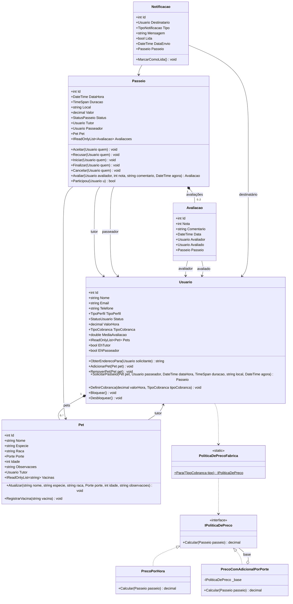

# Modelo de Classes — PetWalk

> Propriedades privadas omitidas do diagrama: `_endereco`, `_pets`, `_avaliacoesRecebidas` (Usuario); `_avaliacoes` (Passeio); `_vacinas` (Pet). Construtores privados para materialização pelo EF Core também omitidos.
