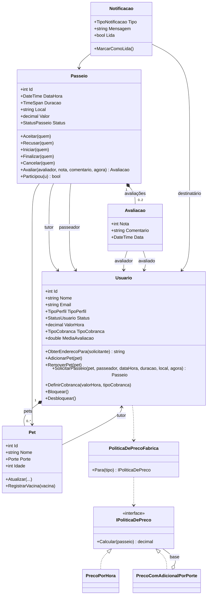

## 1. Resultado item a item

### A — Aplicação dos conceitos de POO (8/8 ✅)

| Item | Status | Evidência encontrada |
|---|---|---|
| A01 | ✅ | `Usuario`, `Pet`, `Passeio`, `Avaliacao`, `Notificacao` (`Dominio/`) |
| A02 | ✅ | `Passeio.Aceitar/Recusar/Iniciar/Finalizar/Cancelar/Avaliar`, `Usuario.SolicitarPasseio/DefinirCobranca` |
| A03 | ✅ | REG-001 a REG-011 implementadas e usadas pelos endpoints |
| A04 | ✅ | `Usuario.SolicitarPasseio` → `Passeio` → `IPoliticaDePreco`; `Passeio.Avaliar` → `Avaliacao` → `Usuario.RegistrarAvaliacaoRecebida` |
| A05 | ✅ | `Passeio` com 6 estados (`StatusPasseio`) e transições por métodos |
| A06 | ✅ | `ExigirStatus` lança antes de atribuir `Status`; estado preservado |
| A07 | ✅ | setters privados, `_endereco` privado + `ObterEnderecoPara`, coleções `IReadOnlyList`, `DefinirId` `internal` |
| A08 | ✅ | `IPoliticaDePreco` + `PrecoPorHora` + `PrecoComAdicionalPorPorte`, escolhidas por `PoliticaDePrecoFabrica` e usadas em `Usuario.SolicitarPasseio` |

### B — Modelos de classes (0/8 ❌)

| Item | Status | Situação |
|---|---|---|
| B01 | ❌ | Não existe modelo textual (Mermaid/PlantUML) no repo |
| B02 | ❌ | Depende de B01 |
| B03 | ❌ | Depende de B01 |
| B04 | ❌ | Depende de B01 (a associação existe no código: `Usuario` 1 — 0..* `Pet`) |
| B05 | ❌ | Depende de B01 (candidata: `Passeio` ◆— `Avaliacao`) |
| B06 | ❌ | Depende de B01 (contrato e implementações existem no código) |
| B07 | ❌ | Depende de B01 |
| B08 | ❌ | Não há decisões de modelagem com alternativas comparadas (a `proposta.md` justifica a variação polimórfica, mas não compara alternativas) |

### C — Análise crítica de código (0/6; 1 incerto)

| Item | Status | Situação |
|---|---|---|
| C01 | ⚠️ | Existem commits funcionais com diff (ex.: `f57b1d1`, `b22819d`), mas nenhum documento seleciona uma alteração |
| C02 | ❌ | Sem documento ligando a alteração a um requisito/regra |
| C03 | ❌ | Sem inventário dos arquivos modificados |
| C04 | ❌ | Sem análise de impacto |
| C05 | ❌ | Sem avaliação de propriedades de POO sobre o diff |
| C06 | ❌ | Sem decisão técnica (aceitar/corrigir/rejeitar) |

### D — Controle de exceções (1 ✅, 2 ⚠️, 1 ❌)

| Item | Status | Situação |
|---|---|---|
| D01 | ⚠️ | O contrato 400/422/404/409/403/401 está na proposta, mas não há 3 situações de falha classificadas como *violação de regra* vs. *situação excepcional* |
| D02 | ✅ | `Passeio.Aceitar` lança → `ExecutarAcao` captura → `ErroHttp.Erro` → 422 (coberto em `PasseioEndpointsTests`) |
| D03 | ❌ | `ErroHttp.Erro` faz `_ => throw ex`; não há `UseExceptionHandler`, nem log, nem resposta 500 padronizada. Em ambiente de desenvolvimento a página de exceção pode expor stack trace |
| D04 | ⚠️ | Há testes para 400/404/409/403/422, mas não para uma falha excepcional (depende de D01 e D03) |

> **Nota de atualização (subetapa 9.2):** o tratamento central de exceções foi implementado após esta avaliação: `Program.cs` registra `ErroDePersistenciaHandler`, `UseExceptionHandler()` e `AddProblemDetails()`, e `EndpointsFalhaDePersistenciaTests` cobre 500 em três rotas (`Cadastro_FalhaAoSalvar_Devolve500`, `CriarPet_FalhaAoSalvar_Devolve500`, `AtualizarPet_FalhaAoSalvar_Devolve500`). Os status ❌/⚠️ desta tabela são históricos e não foram alterados.

### E — Depuração (0/6 ❌)

| Item | Status | Situação |
|---|---|---|
| E01–E06 | ❌ | Não existe registro de depuração. **Material aproveitável:** o commit `f57b1d1` ("Corrigir a média de avaliação") corrigiu um defeito real e adicionou `MediaAvaliacaoTests.cs`, mas sem documentar reprodução, hipótese, técnica e verificação |

### F — Testes, rastreabilidade e auditoria (3/6; 1 incerto)

| Item | Status | Evidência / situação |
|---|---|---|
| F01 | ✅ | Testes de sucesso e violação para as regras (`SolicitacaoDePasseioTests` 23, `AvaliacaoTests`, `UsuarioTests`, `PasseioEndpointsTests`…) |
| F02 | ✅ | Testes tentam transição proibida e conferem `Status` inalterado |
| F03 | ✅ | `FluxoCompletoTests` (`WebApplicationFactory<Program>`) executa o fluxo pela API e lê de volta pelos endpoints. *Observação: o teste usa SQLite em memória via `PetWalkApiFactory`; a aplicação persiste em arquivo SQLite.* |
| F04 | ⚠️ | README tem instruções, mas **não verifiquei** build/testes em clone limpo |
| F05 | ❌ | Não há matriz de rastreabilidade fluxo ↔ regra ↔ implementação ↔ teste |
| F06 | ❌ | Não há auditoria final |

### G — Especificação e agentes (0/2; 1 incerto)

| Item | Status | Situação |
|---|---|---|
| G01 | ⚠️ | `proposta.md` tem fluxos, regras e colunas Sucesso/Falha, mas não há critérios de aceitação verificáveis (Dado/Quando/Então) para os 3 fluxos e 5 regras escolhidos |
| G02 | ❌ | Sem especificação para agente (o PDF escreve "DsCode") nem evidência de inspeção |

---

## 2. Decisões que destravam vários itens (tomar primeiro)

O PDF fala em **"três fluxos"** e **"cinco regras de negócio"**. A `proposta.md` já declara os três fluxos da AV2 (FLX-002, FLX-004, FLX-005). Falta **fixar as cinco regras**. Sugestão, por serem as mais ricas em teste e em estado:

| Regra | Por quê |
|---|---|
| REG-001 (avaliação) | Cruza `Avaliacao`, `Passeio`, `Usuario` e tem 3 falhas distintas |
| REG-003 (só o passeador escolhido e ativo age) | Protege o ciclo de vida |
| REG-004 (cancelar só em SOLICITADO/ACEITO) | Transição proibida clara |
| REG-005 (pet pertence ao tutor) | Multiplicidade e posse |
| REG-008 (data futura) | Usa o relógio injetado, bem testável |

Registre essa escolha em `docs/av2/especificacao.md` (passo G01) e reuse a mesma lista em B, F05 e F06.

**Estrutura de pastas a criar:**
```
docs/av2/
├── evidencias.json          # índice (passo final)
├── especificacao.md         # G01
├── modelo-de-classes.md     # B01–B07
├── analise-do-modelo.md     # B08
├── revisao-de-codigo.md     # C01–C06
├── registro-de-depuracao.md # E01–E06
├── especificacao-agente.md  # G02
├── matriz-rastreabilidade.md# F05
└── auditoria-final.md       # F06
```

---

## 3. Plano de implementação por requisito faltante

Ordem sugerida: **README → G01 → B → D → E → C → G02 → F → evidencias.json.** (G01 e B fornecem o vocabulário usado nos demais; D03 gera a alteração ideal para C e G02.)

### Etapa 1 — G01: Especificação verificável

1. Criar `docs/av2/especificacao.md`.
2. Para **cada um dos 3 fluxos** (FLX-002, FLX-004, FLX-005): ator, pré-condições, passos, resultado, estado final.
3. Para **cada uma das 5 regras**: enunciado, objetos envolvidos e critérios de aceitação no formato **Dado / Quando / Então**, usando as mensagens exatas do código. Exemplo:
   ```
   REG-004 — Cancelamento
   Dado um passeio EM_ANDAMENTO
   Quando o tutor tenta cancelar
   Então a operação é rejeitada com 422 e "Passeio não pode ser cancelado no estado atual."
   E o status permanece EM_ANDAMENTO
   ```
4. Incluir os estados e a tabela de transições permitidas/proibidas (copiar da `proposta.md`).
5. Conferir que cada critério corresponde a um comportamento real (não listar nada que o código não faça).

**Pronto quando:** cada regra tem ≥ 1 critério de sucesso e ≥ 1 de violação, e as mensagens batem com o código.

---

### Etapa 2 — B01 a B07: Modelo de classes textual

1. Criar `docs/av2/modelo-de-classes.md` com um bloco Mermaid (renderiza no GitHub). Ponto de partida **fiel ao código atual**:


   > Revise cada atributo/método contra o código antes de entregar: o item B03 reprova contradições.

2. **B01** — o bloco acima, com as 5 classes de domínio.
3. **B02** — acrescentar uma tabela `Classe do modelo → arquivo C#` (ex.: `Passeio → backend/Projeto.Api/Dominio/Passeio.cs`) para pelo menos 5 classes.
4. **B03** — tabela de atributos/métodos relevantes por classe, com a nota "propriedades privadas omitidas: `_endereco`, `_pets`, `_avaliacoes`".
5. **B04** — destacar `Usuario 1 — 0..* Pet`. Provar a multiplicidade com **cenários de teste**: criar `Fabrica`/teste com tutor com 0, 1 e 2 pets e mostrar que `SolicitarPasseio` só aceita pet da própria lista (já há `SolicitacaoDePasseioTests`; referenciar os métodos).
6. **B05** — documentar a composição `Passeio ◆— Avaliacao`: a `Avaliacao` é criada dentro de `Passeio.Avaliar` e guardada em `_avaliacoes`; não existe fora de um passeio. Citar o trecho e o teste de `AvaliacaoTests`.
7. **B06** — seção "Polimorfismo": contrato `IPoliticaDePreco`, as duas implementações, e quem usa (`Usuario.SolicitarPasseio` via `PoliticaDePrecoFabrica`). Referenciar `PoliticaDePrecoTests`.
8. **B07** — seção "Invariantes": ex. "um passeio só muda de estado por transição válida — protegida por `Passeio.ExigirStatus`" e "um avaliador avalia o passeio uma única vez — protegida por `Passeio.Avaliar`". Incluir uma invariante que ultrapassa uma instância (REG-010, e-mail único, protegida por `AutenticacaoServico` + repositório).

**Pronto quando:** o Mermaid renderiza no GitHub e cada elemento citado existe no código.

---

### Etapa 3 — B08: Duas decisões de modelagem comparadas

Criar `docs/av2/analise-do-modelo.md`. O histórico do próprio repositório já fornece duas decisões reais:

**Decisão 1 — Um único `Usuario` com `TipoPerfil` (vs. classes `Tutor` e `Passeador`)**
- Alternativa A: `Tutor` e `Passeador` separados (existiu no início; removidos no commit `c171558`, "Apagar Tutor.cs e Passeador.cs").
- Alternativa B (adotada): `Usuario` + `TipoPerfil { TUTOR, PASSEADOR, AMBOS }`.
- Comparar: usuário que é os dois papéis, duplicação de e-mail/senha/login, REG-010, custo de herança, regras REG-002/009 baseadas em `EhTutor/EhPasseador`.
- Justificar com código: `Usuario.EhTutor`, `Usuario.EhPasseador`, `AutenticacaoServico`.

**Decisão 2 — Política de preço por interface (vs. `switch` em `Passeio` ou subclasses de `Passeio`)**
- Alternativa A: `if/switch` por `TipoCobranca` dentro de `Passeio`.
- Alternativa B: subclasses `PasseioPorHora`/`PasseioComAdicional`.
- Alternativa C (adotada): `IPoliticaDePreco` + `PoliticaDePrecoFabrica`.
- Comparar: acréscimo de nova cobrança sem alterar `Passeio` (aberto/fechado), `Valor` calculado uma vez na solicitação, testabilidade isolada.

*(Opcional, se quiser uma terceira: estado como enum `StatusPasseio` vs. booleanos.)*

**Pronto quando:** cada decisão tem ≥ 2 alternativas, critérios de comparação e justificativa apoiada em arquivos/linhas reais.

---

### Etapa 4 — D01, D03, D04: Controle de exceções

**D03 — tratamento central de falhas excepcionais (mudança de código)**
1. Em `Program.cs`, registrar um handler central antes dos endpoints:
   ```csharp
   app.UseExceptionHandler(erro => erro.Run(async ctx =>
   {
       var ex = ctx.Features.Get<IExceptionHandlerFeature>()?.Error;
       var logger = ctx.RequestServices.GetRequiredService<ILoggerFactory>().CreateLogger("PetWalk");
       logger.LogError(ex, "Falha inesperada em {Metodo} {Caminho}", ctx.Request.Method, ctx.Request.Path);

       ctx.Response.StatusCode = StatusCodes.Status500InternalServerError;
       await ctx.Response.WriteAsJsonAsync(new { erro = "Erro interno. Tente novamente mais tarde." });
   }));
   ```
2. Manter `ErroHttp.Erro` convertendo apenas `ArgumentException` (400) e `InvalidOperationException` (422). O `_ => throw ex` passa a ser a propagação intencional até o handler. Comentar isso no código.
3. Garantir que o handler **registra** a exceção (não oculta) e **não devolve** `ex.Message`/stack trace ao usuário.

**D01 — três situações de falha, documentadas**
1. Adicionar em `docs/av2/especificacao.md` uma seção "Falhas" com três casos distintos:

   | # | Situação | Tipo | Comportamento esperado |
   |---|---|---|---|
   | 1 | Entrada inválida (ex.: nota 0 ou 6) | Validação | 400 + `"Nota deve estar entre 1 e 5"`; nada é alterado |
   | 2 | Regra de negócio violada (ex.: avaliar passeio não finalizado; cancelar `EM_ANDAMENTO`) | Violação de regra | 422 + mensagem da regra; estado inalterado |
   | 3 | Falha inesperada (ex.: repositório lança `Exception`) | Excepcional | 500 + mensagem genérica; detalhe só no log |

2. Explicar o critério de distinção (o que o usuário pode corrigir vs. o que não pode), apoiado em `ErroHttp.cs`.

**D04 — testes das três situações**
1. Casos 1 e 2: já existem testes; referenciar nomes de métodos específicos.
2. Caso 3: criar `FalhaInesperadaTests.cs` com `WebApplicationFactory<Program>`, substituindo `IPasseioRepositorio` por um *fake* que lança `Exception("segredo-interno")` (via `WithWebHostBuilder` + `ConfigureTestServices`). Verificar: status 500, corpo contém a mensagem genérica, corpo **não** contém `segredo-interno` nem `StackTrace`.
3. Verificar que o estado não ficou inconsistente (ex.: nenhuma notificação criada).

**Pronto quando:** `dotnet test` passa com o novo teste e o log mostra a exceção registrada.

---

### Etapa 5 — E01 a E06: Registro de depuração

Criar `docs/av2/registro-de-depuracao.md`. Duas opções (escolha **uma**):

- **Opção A (real, mais barata):** reproduzir o defeito corrigido em `f57b1d1`. Rode `git checkout f57b1d1^`, escreva/rode um teste que falha e use o histórico como "linha de base".
- **Opção B (controlada):** em uma branch `debug/media-avaliacao`, introduzir um defeito deliberado (ex.: `MediaAvaliacao` calculada só com a última nota) e investigá-lo.

Passos do registro:

1. **E01** — Descrever o defeito e anexar a evidência do comportamento incorreto (saída do teste vermelho, ou requisição + resposta).
2. **E02** — Condições de reprodução (passos exatos, dados), **comportamento esperado** (ex.: avaliações 5 e 3 → média 4,0) e **observado** (ex.: 3,0).
3. **E03** — Escrever ≥ 1 hipótese ("a média usa só a avaliação mais recente") e o experimento que a confirma/descarta, com evidência.
4. **E04** — Aplicar e **comprovar** uma técnica: inspeção em breakpoint em `Usuario.RegistrarAvaliacaoRecebida` (print do depurador com `_avaliacoesRecebidas.Count`) **ou** log temporário com `ILogger` (colar a saída).
5. **E05** — Declarar a causa raiz (distinguindo *causa* de *localização*), mostrar o diff da menor correção coerente e o teste que passa a ficar verde.
6. **E06** — Tabela **antes/depois** (saída do teste/endpoint) + comparação fundamentada entre a técnica usada e uma alternativa (ex.: breakpoint × logs × teste automatizado), com critérios (intrusividade, repetibilidade, custo, adequação a código em produção) e uma recomendação. Rodar a suíte completa para provar não regressão.

**Pronto quando:** qualquer pessoa reproduz o defeito seguindo o documento e vê a correção eliminá-lo.

---

### Etapa 6 — C01 a C06: Revisão de código de uma alteração

Criar `docs/av2/revisao-de-codigo.md`. Escolha **uma** alteração funcional ligada ao domínio. Candidatas já no histórico (confirme com `git show <hash>`): `b22819d` (*AdicionarPet exige perfil de tutor* — REG-002) ou `8871eef` (*tirar `DateTime.UtcNow` do domínio* — REG-008). Se preferir, use a mudança do D03 (aplicada via PR). Evite usar a mesma alteração do registro de depuração.

1. **C01** — Identificar commit/PR, autor, data, e anexar `git show --stat` e o trecho relevante do diff.
2. **C02** — Ligar a alteração a um requisito/regra (ex.: REG-002) e mostrar *onde* o código implementa o critério de aceitação da `especificacao.md`.
3. **C03** — Inventário (tabela) dos arquivos alterados: arquivo, finalidade, dentro/fora do escopo. Apontar explicitamente qualquer mudança fora do escopo (ou declarar que não há).
4. **C04** — Análise de impacto local e transitivo: quem chama o método alterado (`grep`/busca de referências), contratos afetados (DTOs, mensagens de erro, status HTTP), testes impactados. **Acompanhar de verificação**: colar `dotnet test` antes/depois.
5. **C05** — Avaliar ≥ 2 propriedades de POO sobre o diff (ex.: *encapsulamento*: setter privado preservado? *responsabilidades*: regra no domínio e não no endpoint? *acoplamento*, *coesão*).
6. **C06** — Parecer: **aceitar / corrigir / rejeitar**, separando fatos (diff, testes) de julgamento, com as razões.

**Pronto quando:** o documento permite a um revisor tomar a decisão sem abrir mais nada além do diff citado.

---

### Etapa 7 — G02: Especificação para agente de código

Criar `docs/av2/especificacao-agente.md`. (O PDF escreve "DsCode"; use a mesma ferramenta/agente que o grupo de fato utilizou, e nomeie-a no documento.)

1. **Contexto** para o agente: stack (.NET 10, xUnit, React/Vite), pastas, convenções (mensagens de erro da `proposta.md`, `agora` injetado, setters privados).
2. **Pedido delimitado**: associado a uma alteração funcional concreta (ideal: o D03 ou outra regra), com escopo, arquivos permitidos, o que **não** pode mudar e critérios de aceitação.
3. **Plano esperado** e comandos de verificação (`dotnet test`).
4. **Evidência de inspeção**: diff produzido, resultado dos testes, checklist de revisão preenchido e eventuais correções feitas à saída do agente.
5. Linkar a alteração ao commit/PR correspondente.

**Pronto quando:** o pedido, o diff resultante e a verificação estão conectados e é possível repetir o processo.

---

### Etapa 8 — F04: Build e testes em clone limpo

1. Em outra pasta/máquina: `git clone https://github.com/SilMonteiro/PetWalk && cd PetWalk/backend && dotnet restore && dotnet test`. Registrar o resultado (nº de testes, tempo, SDK).
2. Se falhar, corrigir README (versão do SDK, pré-requisitos) ou projeto.
3. ~~Acrescentar ao README: saída esperada e uma linha informando que o armazenamento é **em memória** (não há banco a preparar).~~ **Substituído (subetapa 9.2):** o README atual documenta SQLite em arquivo, a localização do banco, as migrations e a limitação dos testes bloqueados pelo App Control.
4. **Recomendado:** criar `.github/workflows/ci.yml` (`actions/setup-dotnet` com `10.0.x`, `dotnet restore`, `dotnet build --no-restore`, `dotnet test --no-build`) e linkar o run verde no documento de auditoria como evidência de "gate técnico".

---

### Etapa 9 — F05: Matriz de rastreabilidade

Criar `docs/av2/matriz-rastreabilidade.md` com tabelas **fluxo → regra → implementação → teste**, uma linha por vínculo, citando `arquivo:Classe.Método`. Exemplo:

| Fluxo | Regra | Implementação | Teste |
|---|---|---|---|
| FLX-002 | REG-008 | `Usuario.SolicitarPasseio` (`Dominio/Usuario.cs`) | `SolicitacaoDePasseioTests.<método>` |
| FLX-002 | REG-005 | `Usuario.SolicitarPasseio` / `PasseioEndpoints.Solicitar` | `<método>` |
| FLX-004 | REG-003 / REG-004 | `Passeio.Finalizar`, `ExigirPasseadorAtivo` | `<método>` |
| FLX-005 | REG-001 / REG-006 | `Passeio.Avaliar`, `Avaliacao` (construtor) | `AvaliacaoTests.<método>` |

Preencha `<método>` com nomes reais (`grep -n "public void\|public async" Projeto.Tests/*.cs`). **Todas** as 5 regras e os 3 fluxos precisam aparecer; nenhuma linha pode apontar para teste inexistente.

---

### Etapa 10 — F06: Auditoria final

Criar `docs/av2/auditoria-final.md`:

1. Tabela dos 40 itens: **item → status → evidência (arquivo/commit/saída de teste) → pendência/limitação**.
2. Seção "Limitações conhecidas", declarando honestamente o que **não** existe: banco compartilhado entre máquinas (a persistência é SQLite local em arquivo), ausência de autenticação por token (quem age é informado pelo cliente — risco já registrado na proposta), sem agenda/pagamento.
3. Não marcar como concluído nada que não tenha evidência executável.
4. Anexar saída final de `dotnet test` e, se existir, o link do CI.

---

### Etapa 11 — evidencias.json (índice)

Criar `docs/av2/evidencias.json` mapeando cada item a arquivos reais:

```json
{
  "A01": { "evidencias": ["backend/Projeto.Api/Dominio/Usuario.cs", "backend/Projeto.Api/Dominio/Passeio.cs"] },
  "B01": { "evidencias": ["docs/av2/modelo-de-classes.md"] },
  "D03": { "evidencias": ["backend/Projeto.Api/Program.cs", "backend/Projeto.Tests/FalhaInesperadaTests.cs"] },
  "F05": { "evidencias": ["docs/av2/matriz-rastreabilidade.md"] }
}
```
Cobrir **os 40 itens** e validar que todo caminho listado existe (`jq -r '.. | strings' docs/av2/evidencias.json | xargs ls`). O índice não substitui implementação nem testes.

---

## 4. Checklist final antes de entregar

- [ ] README com `## Integrantes` (plural) e 5 nomes completos
- [ ] `main` contém a versão a ser avaliada
- [ ] `dotnet test` verde em clone limpo (F04)
- [ ] Modelo Mermaid confere com o código (B01–B07)
- [ ] 5 regras e 3 fluxos fixados e usados em G01, F05 e F06
- [ ] Falha excepcional tratada + testada (D03/D04)
- [ ] Depuração, revisão e especificação para agente documentadas com evidências (E, C, G02)
- [ ] Auditoria final sem declarar como concluído o que não foi comprovado (F06)
- [ ] `evidencias.json` cobrindo os 40 itens, com caminhos válidos

## 5. Projeção de nota

| Cenário | Itens | Nota |
|---|---:|---:|
| Hoje (após corrigir só o README) | 12 | 3,00 |
| + fechar os 5 incertos (G01, D01/D04, F04, C01) | 17 | 4,25 |
| + Etapas 2–3 (B) | 25 | 6,25 |
| + Etapas 4 (D03), 5 (E), 6 (C), 7 (G02), 9–10 (F05/F06) | 40 | 10,00 |
